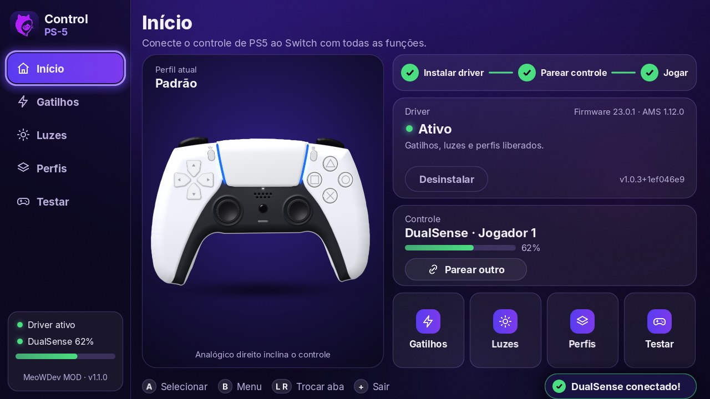
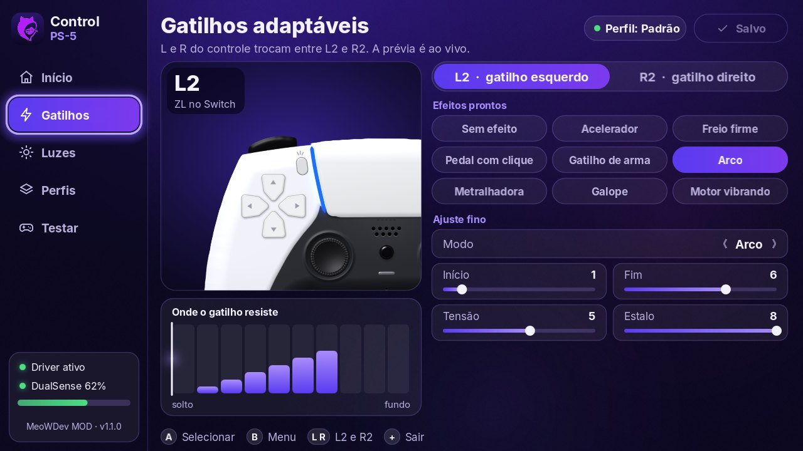
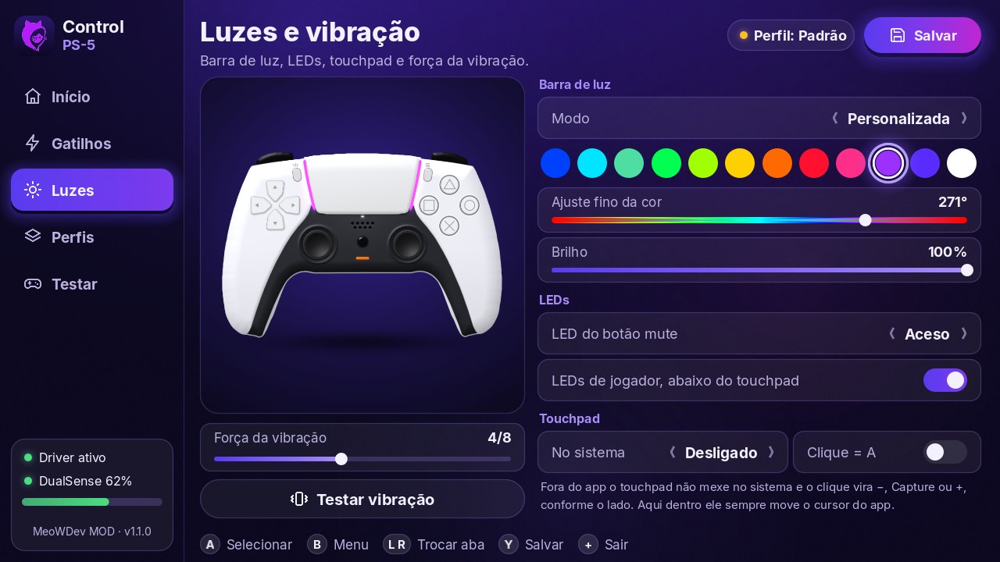

# Control PS-5

🌐 **[Ler em português](README.md)**

Connect the PS5 controller (DualSense) to a hacked Nintendo Switch over Bluetooth, with no adapter, with **adaptive triggers, light bar, touchpad as cursor and per-game profiles**.
One app, one tap on Install.

**Project page:** https://techmeow.app/Control-PS-5/en/ · also in [Español](https://techmeow.app/Control-PS-5/es/) and [Русский](https://techmeow.app/Control-PS-5/ru/)

## Install

**1. Put the app on the SD card**

1. In the CNX pack, hold **R** and open the **Album** to enter the Homebrew menu.
2. Open **DBI** and start the **MTP connection**.
3. Plug the Switch USB cable into the computer.
4. On the computer, open the **Switch** device, go to **1: SD Card** and then **switch**
   (`This PC\Switch: SD Card\switch`).
5. Copy the unzipped **Control PS-5** folder there (download the zip from
   [Releases](https://github.com/MeoWDev-MOD/Control-PS-5/releases/latest)).
6. Leave DBI and go back to the Homebrew menu (**R** + **Album**). Control PS-5 appears in the list.

> No cable? Take the SD card out, put the `Control PS-5` folder inside `switch` on the computer and put the card back.

**2. Install the driver and pair**

1. On the **Home** screen, tap the purple **Install driver** button. When it finishes, the app asks you to restart the Switch.
2. With the Switch back on, open Control PS-5 again.
3. Tap **Pair controller** and choose **Change Grip/Order**.
4. On the controller, hold **Create** and **PS** until the light bars blink.
5. Press **L1** and **R1**. When it syncs, a black controller appears on screen and the light bars stay on.
6. Go back to the app and set up triggers, lights and profiles.

> First, make a copy of the `atmosphere/contents/010000000000bd00` folder on the SD card.
> If something goes wrong, **Uninstall** in the app restores the original MissionControl.

## Screenshots

| Home | Triggers | Lights and vibration |
|---|---|---|
|  |  |  |

The app's interface is in Portuguese.

## Compatibility

- Switch with Atmosphère (CNX pack).
- **Requires firmware 23.0.1 and Atmosphère 1.12.0** (the versions the driver was built and tested on).
- DualSense and DualSense Edge.

## Legal notice

MeoWDev MOD's homebrews and modifications were not made to promote or encourage piracy. Control PS-5 does not include, download or install games, and it does not touch any game's protection. We know there are ill-intentioned people who use hacking for piracy, but that is not the purpose of this project. Use original games and programs you have the right to use.

The controller is compatible with the console, but the stock system does not accept it. That is why the connection is only possible after hacking, which allows installing this driver.

This is an independent project, with no ties to, approval from or sponsorship by Sony or Nintendo. We do not use these companies' logos. DualSense, PlayStation, PS5 and Nintendo Switch are trademarks of their owners, mentioned only to indicate which console and which controller the app works with.

Each person is responsible for how they use the console and the app. This notice is informative and is not legal advice. Full text, with the laws cited: [Legal notice](https://techmeow.app/Control-PS-5/en/#aviso-legal).

## Support the project

The app is free. Pix (Brazilian instant payment): **21966547296**

## Credits and notice

Driver based on [MissionControl](https://github.com/ndeadly/MissionControl) (ndeadly, GPLv2) on top of
[Atmosphère](https://github.com/Atmosphere-NX/Atmosphere), with libnx and devkitPro.
Independent project, not affiliated with Sony or Nintendo. Does not enable piracy. Use at your own risk.

Developed by **MeoWDev MOD**.
