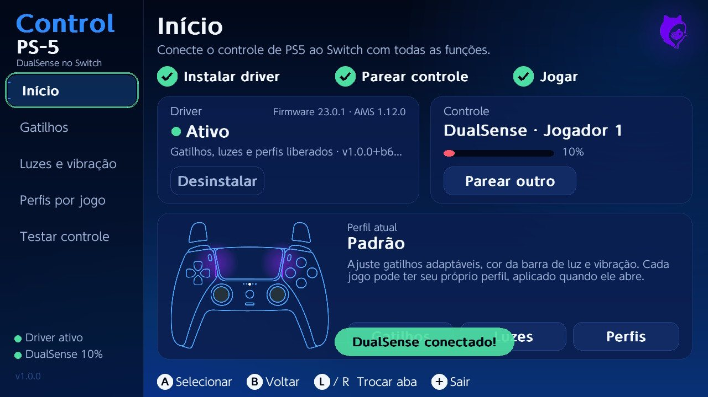
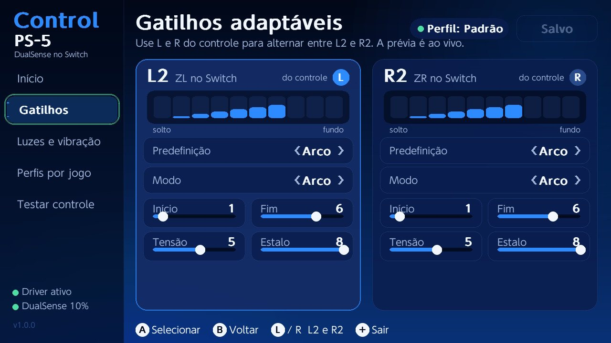
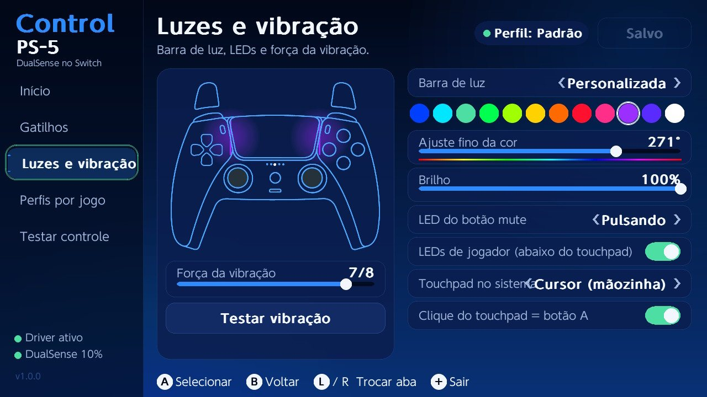

# Control PS-5

Use o controle de PS5 (DualSense) no Nintendo Switch com **gatilhos adaptáveis, barra de luz, touchpad e perfis por jogo**.
Um app, um toque em Instalar.

**Página do projeto:** https://meowdev-mod.github.io/Control-PS-5/

## Instalar

**1. Levar o app para o cartão SD**

1. No pacote CNX, segure **R** e abra o **Álbum** para entrar no menu Homebrew.
2. Abra o **DBI** e inicie a **conexão MTP**.
3. Conecte o cabo USB do Switch ao computador.
4. No computador, abra o dispositivo **Switch**, entre em **1: SD Card** e depois em **switch**
   (`Este Computador\Switch: SD Card\switch`).
5. Copie para lá a pasta já descompactada **Control PS-5** (baixe o zip em
   [Releases](https://github.com/MeoWDev-MOD/Control-PS-5/releases/latest)).
6. Saia do DBI e volte ao menu Homebrew (**R** + **Álbum**). O Control PS-5 aparece na lista.

> Sem cabo: tire o cartão SD, coloque a pasta `Control PS-5` dentro de `switch` no computador e devolva o cartão.

**2. Instalar o driver e parear**

1. Na tela **Início**, toque no botão azul **Instalar**. Quando terminar, o app pede para reiniciar o Switch.
2. Com o Switch ligado de novo, abra o Control PS-5 outra vez.
3. Toque em **Parear controle** e escolha **Mudar ordem ou modo de segurar**.
4. No controle, segure **Create** e **PS** até as barras de luz piscarem.
5. Aperte **L1** e **R1**. Quando sincronizar, um controle preto aparece na tela e as barras de luz ficam fixas.
6. Volte ao app e configure gatilhos, luzes e perfis.

> Antes, faça uma cópia da pasta `atmosphere/contents/010000000000bd00` do cartão SD.
> Se algo der errado, **Desinstalar** no app restaura o MissionControl original.

## Capturas

| Início | Gatilhos | Luzes e vibração |
|---|---|---|
|  |  |  |

## Compatibilidade

- Switch com Atmosphère (pacote CNX).
- **Requer firmware 23.0.1 e Atmosphère 1.12.0** (versões em que o driver foi construído e testado).
- DualSense e DualSense Edge.

## Apoie

O app é gratuito. Pix: **21966547296**

## Créditos e aviso

Driver baseado no [MissionControl](https://github.com/ndeadly/MissionControl) (ndeadly, GPLv2) sobre o
[Atmosphère](https://github.com/Atmosphere-NX/Atmosphere), com libnx e devkitPro.
Projeto independente, sem afiliação com Sony ou Nintendo. Não habilita pirataria. Use por sua conta e risco.

Developed by **MeoWDev MOD**.
